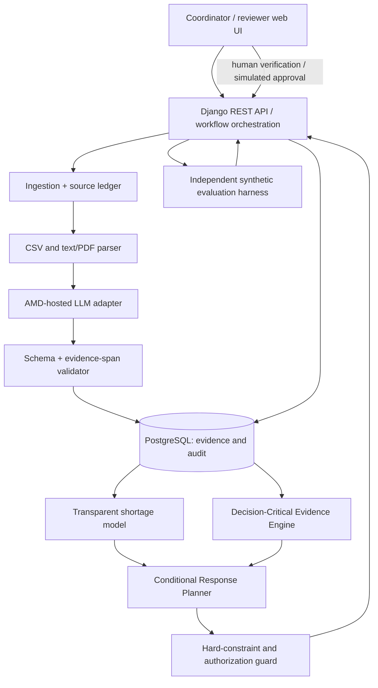

# HealthMesh — System Architecture and Product Design

**Working subtitle:** Verify. Predict. Coordinate.  
**Design version:** 1.0 · **Date:** 2026-10-17 · **Status:** Proposed architecture for team review, **not implementation-approved**  
**Event:** AMD Developer Hackathon: ACT III · **Primary track:** Health & Wellbeing  
**Intended deliverable:** A demonstrable, synthetic-data healthcare supply coordination prototype plus a scalable long-term architecture.

> **One-sentence product:** HealthMesh helps healthcare supply coordinators detect possible medicine shortages, reconcile unreliable inventory reports, ask the most useful verification question, compare conditional transfer plans, and bring a source-backed proposal to a human for approval.
>
> **Safety boundary:** The hackathon version is an *operations simulation and administrative decision-support tool*. It does **not** diagnose patients, advise treatment, recommend medication substitution or dosage, or execute real procurement or medicine transfers.

---

## 1. Design intent and decisions already made

The team has selected HealthMesh after competitive exploration of OpenLMIS, HospiStock, Logistimo, GHX ResiliencyAI, and MedSupply. Some overlap with those products is expected and acceptable. The intent is **not** to reproduce their enterprise suites in a weekend. HealthMesh should provide a credible, working subset of standard inventory and coordination functions, with two connected flagship capabilities:

1. **Decision-Critical Evidence Engine:** determines which missing or conflicting information could materially change the current supply decision and prioritizes verification under limited time.
2. **Conditional Response Planner:** represents possible transfer plans as explicit branches dependent on verified facts, instead of presenting one unjustifiably certain recommendation.

The supporting capabilities are (1) inventory/document ingestion, (2) transparent shortage estimation, (3) constraint-checked supply planning, and (4) human review with audit records. AMD-hosted AI performs essential information extraction and grounded verification-question/explanation generation; deterministic Python modules handle numerical calculations and enforce constraints.

### Success definition

The hackathon is successful if a judge can upload a deliberately inconsistent fictional supply report, observe a **real AMD-backed inference**, inspect sources and uncertainty, see a shortage-risk calculation, receive a targeted verification request, enter a human response, watch the conditional plan change, and review a feasible proposal with a recorded simulated approval. The team must also run reproducible comparisons against non-AI baseline policies and disclose results honestly.

### User and purchaser

- **Primary user:** facility inventory coordinator or pharmacist acting in an *authorized inventory-management capacity*.
- **Secondary user:** regional logistics coordinator reviewing transfer alternatives.
- **Beneficiary:** patients served by the facility, indirectly through more reliable operations (not a demonstrated clinical outcome).
- **Potential adopter/payer after validation:** hospital groups, public health networks, regional medical supply coordinators, or logistics operators. No purchasing agreement is assumed.

### Assumptions chosen for this design

- One demo network of **three fictional facilities**, one fictional catalogued medicine, a single unit of measure, and a single urgent supply request.
- All data is **synthetic**. Do not use real patient records, prescriptions, addresses, staff identities, or actual supply authorization.
- A facility's physical stock, reserved stock, minimum protected reserve, document freshness, and transport feasibility are distinct variables.
- The application is a **responsive web app**. Desktop is the primary demonstration viewport; it should remain usable on mobile.
- The prototype uses **human confirmation** for potentially consequential facts; AI-generated text cannot silently change verified inventory figures.
- The technology stack below is a recommended reference implementation, not a requirement to install every component.

## 2. Hackathon requirements and AMD compliance

The official event rules say that **AMD must power a meaningful part of the working product**. Accepted infrastructure includes AMD Developer Cloud, AMD Instinct, AMD ROCm, AMD Ryzen AI, AMD Radeon, or approved AMD-powered event infrastructure. The event FAQ states that access to an API through its AMD Token Factory is sufficient to participate and that the $100 cloud credit is not mandatory. **Availability and exact API schema must be verified after signing in; do not invent an endpoint or assert support for a specific model without a successful call.**

**Selected AMD integration (primary, lowest-friction):** use a supported LLM API made available at the event's [AMD Token Factory](https://notebooks.amd.com/tokenfactory) or another organizer-approved AMD-served endpoint, called from our backend via a configurable adapter. Use that endpoint for the core unstructured-report extraction/reconciliation workload; it is not a decorative chatbot. Log a sanitized inference receipt (provider, model ID, timestamp, latency, status, request ID if exposed, and input/output schema versions), so the judges can see actual AMD inference occurred. Do not log full unredacted prompts or API keys.

**Optional alternate:** if credits, time, and model support allow, deploy an open-weight model on **AMD Developer Cloud / AMD Instinct with ROCm and vLLM**. This is a fallback or expansion, **not** a dependency for the main MVP. A Gemma-on-AMD deployment may open an optional Google partner-award route if eligible; never prioritize that over a working main-track submission. **Evolus is not in scope** because its partner track has additional requirements (workspace, building blocks, own AMD-served model) and is not required for Track 2.

**Evidence of compliance in demo:** show a live input → backend AMD inference → validated extracted evidence → downstream verification/plan change. Show the adapter configuration with secrets hidden and a real inference receipt. Include a short README section identifying exactly which workload ran on AMD and how to reproduce it.

**Submission checklist:** public GitHub repo with README, runnable hosted application URL, short/long description, selected track and technology tags, cover image, video presentation, and slide deck. **Verify the actual submission deadline in the participant dashboard**: the main event page lists online October 12–18, whereas the live dashboard has displayed online build October 12–17; do not infer an exact local cutoff from either marketing line.

**Official references:**
- [AMD Developer Hackathon ACT III — challenges, rules, judging and submission](https://lablab.ai/ai-hackathons/amd-developer-hackathon-act-iii)
- [Live event dashboard](https://lablab.ai/ai-hackathons/amd-developer-hackathon-act-iii/live)
- [AMD Token Factory event login](https://notebooks.amd.com/tokenfactory)
- [AMD ROCm documentation](https://rocm.docs.amd.com/)

## 3. Problem, constraints, and value proposition

### Current workflow

Facilities maintain stock estimates in unrelated spreadsheets, manual reports, and informal messages. A requesting facility may be short of an essential item, but a nearby facility's apparent surplus may be outdated, reserved, expired, or otherwise unavailable. A naïve plan can move a shortage to another facility. Checking everything may waste limited staff time or arrive after the urgent deadline.

### Proposed workflow

HealthMesh first creates an **evidence ledger**, then estimates shortage pressure, checks possible supply actions against hard constraints, identifies *which unresolved evidence could change the decision*, asks a targeted verification question, and returns a **conditional plan** for human review. It must be able to say **"cannot recommend from current evidence."**

### Intended competitive differentiator

The differentiator is a single, understandable workflow that unifies **source provenance + verification prioritization + contingent plans + auditable human intervention** for facilities exchanging fragmented reports. These techniques and many individual features already exist elsewhere. The project makes **no world-first or enterprise-superiority claim**. An improvement claim is allowed only when tested against a defined baseline with the same simulation inputs and constraints.

## 4. Product scope and non-goals

| Area | Hackathon MVP (must demonstrate) | Future product (explicitly out of MVP) |
|---|---|---|
| Facilities and catalog | 3 synthetic facilities; 1 product; fixed base unit | Region-scale networks, many SKUs, interchange standards |
| Data ingestion | CSV; one unstructured plain-text/PDF-text report; provenance | Excel/OCR, ERP, FHIR, offline/mobile, SMS |
| Forecast | Simple transparent consumption-based stock coverage | Seasonal and probabilistic multi-SKU forecasting |
| Evidence | Conflicts, timestamps, verification states, source snippets | Enterprise trust policies, complex multi-source reconciliation |
| Verification | Rank 2–3 candidate questions; request and record one answer | Optimal multi-step adaptive inspection policies |
| Planner | Small enumerated network with hard constraints and two branches | Multi-echelon optimization, cold chain, vehicle routing |
| Approval | Simulated approve/reject and append-only event log | Real permissions, institution identity, electronic signatures |
| Reporting | Before/after simulated outcome, baselines and AMD receipt | Audited operational/clinical performance |
| Security | Synthetic-only safeguards, backend secrets, input validation | Compliance audits, PHI processing, real healthcare tenancy |

**Non-goals:** patient intake; individualized medical advice; diagnosis; automatic treatment or substitution; real prescribing; medication selection; unattended physical transfer; guarantees against shortages; asserting actual clinical safety; claiming integration with platforms not connected during the demo.

## 5. End-to-end user journey

1. **Create simulated incident.** Coordinator selects a predefined storm/disruption scenario or imports fresh fictional reports.
2. **Ingest sources.** Upload CSV and one human-written text or text-extractable PDF. Files are hashed and assigned immutable document IDs.
3. **AMD extraction.** The AMD-hosted model returns *candidate* structured facts with exact evidence pointers. The backend schema-validates and displays them as **unverified** unless deterministic or human-verified checks pass.
4. **Reconcile.** The system identifies conflicts, stale timestamps, missing reservations, and unusable units. The UI displays each claim's source and status; it does not silently pick a winner.
5. **Estimate shortage pressure.** Deterministic rolling consumption logic calculates stock cover and raises a possible shortage alert, marking poor-demand-data cases as insufficient evidence.
6. **Generate options.** Planner enumerates feasible/provisional sources and rejects options violating definite constraints. Never silently assume an unknown constraint is satisfied.
7. **Prioritize verification.** Evidence Engine chooses the most decision-relevant *optional* verification request from a bounded list, considering its likely decision benefit, staff effort, response delay, and the decision deadline.
8. **Human answers.** Coordinator enters a simulated confirmed value or marks the request unresolved. System records actor, timestamp, and source.
9. **Replan conditionally.** The planner recomputes. It shows alternative branches if uncertainty persists; if no justified option remains, it abstains.
10. **Review.** The coordinator reviews source evidence, constraints, consequences, and an explicit simulation-only approve/reject control.
11. **Evaluate.** A reproducible results panel compares the outcome with baseline policies on a held-out scenario set. No result is labeled a real patient outcome.

### Workflow state machine

`DRAFT → SOURCES_IMPORTED → EVIDENCE_REVIEW → RISK_ASSESSED → PLAN_PROVISIONAL → [VERIFICATION_REQUESTED → VERIFICATION_RECEIVED] → READY_FOR_REVIEW → SIMULATED_APPROVED / SIMULATED_REJECTED`

Any invalid or essential unknown fact routes to `BLOCKED_INSUFFICIENT_EVIDENCE` or `HUMAN_REVIEW_REQUIRED`. Corrections create **new evidence revisions**, not silent overwrites. `SIMULATED_APPROVED` never dispatches an external order.

## 6. System architecture

### Architecture principles

- **Modular monolith first.** One deployable backend with domain modules is more reliable for a weekend than microservices.
- **AI proposes facts and language; code decides quantities and permissions.** No executable LLM-generated SQL or free-form tool calls against operational actions.
- **Evidence is first-class.** Every decision-critical datum references its source, extraction path, freshness and verification state.
- **Fail closed for critical unknowns.** A model outage or unverified quantity cannot be converted into an approved transfer.
- **Explainable with reproducibility.** Deterministic simulation seeds, logged model metadata, and baseline comparisons.



### Chosen reference stack

| Layer | Choice | Rationale |
|---|---|---|
| Frontend | React + TypeScript + Vite | Clear interactive evidence and branch views; portable static hosting |
| Backend | Python 3.12 + Django + Django REST Framework | Familiar, built-in auth/admin, ORM, migrations, suitable modular monolith |
| Database | PostgreSQL; SQLite only for local demo development | Transactions, relational integrity, auditable revisions |
| LLM | Organizer-approved AMD Token Factory endpoint via `AMDInferenceAdapter` | Mandatory meaningful AMD-backed AI task without local GPU ownership |
| Data processing | Python CSV, pandas when needed; text-PDF extraction using pypdf | Predictable MVP parsing; avoid OCR dependency |
| Optimization | Python enumeration/scoring for 3 facilities; scipy optional | Transparent baseline; avoids unnecessary complex solver |
| Testing | pytest + Django tests + Playwright smoke flow | Unit, integration, UI acceptance and seeded simulation |
| Deployment | Hosted API + managed DB; static frontend; optionally Docker | Accessible public demo, simple redeploy |

The default AMD adapter configuration uses `AMD_API_KEY`, `AMD_API_BASE_URL`, and `AMD_MODEL_ID` supplied by the **actual event-issued quickstart**. Do not hardcode a made-up base URL or assume OpenAI API compatibility until validated. If the supported endpoint has a different protocol, implement that protocol behind the same adapter interface.

### Core module responsibilities

- `sources`: imports, hashes, text segments, structured rows; returns immutable `SourceDocument`/`SourceSpan`.
- `ai_gateway`: calls AMD inference, validates output against a schema, records sanitized metadata; **never** decides transfers.
- `inventory`: canonical product catalog, batches, reservations, observations, verified balances and revisions.
- `forecast`: computes transparent inventory coverage and insufficiency flags; accepts verified/provisional input status.
- `evidence`: detects field-level conflicts; computes verification question candidates, value-of-information estimates and source traceability.
- `planner`: enumerates constrained alternatives and branches; returns provisional or ready-for-review proposals.
- `workflow`: enforces states, role checks, human confirmation and audit events.
- `evaluation`: generates held-out synthetic scenarios, runs policies against hidden truth, calculates comparative metrics.

The modules communicate via typed Python service functions and explicit database records, **not** event buses or inter-service RPC for the MVP.

## 7. Data model and invariants

Use stable UUIDs, UTC timestamps internally, and display local timezone explicitly. A field's value, provenance, and verification status are stored separately. Core entities:

| Entity | Key fields | Rule |
|---|---|---|
| `Facility` | id, pseudonymous name, capabilities, active | Only synthetic demo facilities |
| `Product` | id, fictional SKU, label, `base_unit` | No ingredient/dose equivalence or substitution |
| `StockBatch` | facility_id, product_id, batch_code, on_hand, reserved, protected_reserve, expires_on | Numeric base units must be nonnegative; protected reserve is separate from reserved |
| `SourceDocument` | id, facility_id, kind, sha256, created_at, observed_at, blob_path | Immutable artifact and ingestion metadata |
| `SourceSpan` | document_id, page_or_row, offsets, quoted_text | Supports factual trace-back to a source segment |
| `InventoryClaim` | batch_id or facility-product, field, value, source_span_id, observed_at, status | Claims never overwrite one another; verified values require explicit basis |
| `EvidenceConflict` | field_key, claim_ids, conflict_type, resolved_by, status | Conflict stays open until evidence or a human resolves it |
| `DemandObservation` | facility, product, date, units | Simulated historical demand only |
| `SupplyRequest` | receiver, product, quantity, needed_by, status | Immutable requested quantity per revision |
| `VerificationTask` | question, claim_ids, target_facility, expected_effort, due_at, status, response | A task is a request for evidence, not a transfer authorization |
| `ForecastRun` | model_version, input_snapshot, estimate, assumptions, limitations | Reproducible from frozen inputs |
| `PlanRun` | policy, input_snapshot, branches, constraint_checks, status | Cannot be approved without verified mandatory conditions |
| `TransferProposal` | source, receiver, batch, quantity, conditions, plan_run_id, status | Never connected to real fulfillment in MVP |
| `ReviewDecision` | proposal_id, simulated_actor, approve/reject, rationale, timestamp | Explicit actor action; cannot be generated by LLM |
| `AuditEvent` | actor, action, entity, before_ref, after_ref, time | Append-only; no in-place editing of historical events |
| `AIInferenceReceipt` | provider, model, request_id_if_available, latency_ms, schema_ver, outcome | No credentials, raw PHI, or full prompts |
| `SimulationRun` | seed, scenario_version, policy, metrics, artifact_ref | Hidden truth not visible to planning modules |

**Available-to-transfer formula, per verified usable batch:**

```text
transferable = max(0, on_hand - reserved - protected_reserve)
```

Do not subtract protected reserve twice if local accounting includes it in `reserved`; the ingestion contract must explicitly distinguish those categories. Exclude expired/unusable batches; if expiry or storage acceptability is unverified, block **ready-for-review** status. Before approval in the demo, validate a fresh supply snapshot, compatible base unit, recipient request, delivery feasibility, and protected reserve. Unknown is **not** equivalent to zero risk.

**Important operational statuses:** `OBSERVED_UNVERIFIED`, `CONFLICTED`, `HUMAN_VERIFIED`, `DERIVED_FROM_VERIFIED`, `UNKNOWN`, `STALE`. AI-extracted statements default to `OBSERVED_UNVERIFIED` regardless of the model's self-reported confidence. A timestamp of a newer report does not automatically prove it is accurate.

## 8. AMD AI contract and prompt-security controls

### Input to the AMD extraction model

Sanitized plain text from a synthetic inventory note and a clear field schema. Example input:

```text
Facility: Bayview Clinic (fictional)
Report dated 2026-10-16 09:00
Medication X, batch MX-01: counted 80 boxes, 25 reserved for scheduled clinics.
Previous sheet lists 95 boxes. New count not yet signed off.
```

### Expected validated output (example only)

```json
{
  "claims": [
    {"field": "on_hand", "value": 80, "unit": "box", "source_span_id": "span-001", "is_ambiguous": false},
    {"field": "reserved", "value": 25, "unit": "box", "source_span_id": "span-002", "is_ambiguous": false}
  ],
  "unresolved_questions": [
    {"field": "on_hand", "reason": "The new count has not been signed off."}
  ]
}
```

Model-generated IDs must be mapped only to spans that the ingestion layer actually issued; an invented span ID invalidates the claim. JSON syntax and data types are checked deterministically. Amounts and units are cross-checked with quoted evidence; if they do not match, the system asks for human correction. Prompt content is treated as **untrusted data**, never as instructions to override rules or call tools. No LLM-produced output can directly update verified stock or authorize a proposal.

### AMD-backed operations that must really run

1. **Extract** candidate stock quantities, reservations, dates, and uncertainty from a free-form report.
2. **Reconcile language** for a conflict summary grounded in two specific source spans.
3. **Draft** a precise verification request from the engine's *selected field and evidence*, not from free-form agent autonomy.

The numerical verification ranking and branch feasibility remain deterministic. If AMD is unavailable, the system may let an operator import strict CSV manually, but the interface must clearly label the AI-powered flow unavailable; do **not** present a mock response as successful AMD processing.

**Inference adapter interface:** `extract_claims(text, allowed_spans, schema_version) -> ExtractionResult`, `explain_conflict(conflict_id, evidence) -> GroundedExplanation`, `draft_verification(task, evidence) -> SuggestedMessage`. All operations have timeouts, limited retries for safe idempotent calls, maximum input sizes, output schema validation, and distinct unavailable/invalid states. Store an `AIInferenceReceipt` for each completed call.

## 9. Forecasting and risk model

The MVP **does not ask an LLM to forecast demand**. For facility `f`, product `p`, and recent known consumption values, use a rolling average of the last `N` valid days (default `N=14` in synthetic fixtures):

```text
mean_daily_demand = sum(units_consumed_on_valid_days) / valid_day_count
usable_on_hand = sum(verified, unexpired, unreserved, usable batches)
days_of_cover = usable_on_hand / mean_daily_demand   [if demand > 0]
```

Protected reserve is not counted as transferrable; for shortage alerts define and document whether protection is included in local-serving stock according to the scenario's accounting policy. If historical data is absent or inconsistent, display `insufficient demand history` rather than manufacturing an estimate. For the small MVP, a scenario-defined reorder/coverage threshold raises an alert; the threshold is an **administrative demo policy**, not a clinical standard.

For richer scenarios, report a simple range based on historical demand variability. Do not present such a range as calibrated probabilistic confidence unless it has been back-tested. Always show calculation inputs and provenance.

## 10. Decision-Critical Evidence Engine (flagship feature 1)

### Purpose

Given request `r`, available claims `C`, allowed feasible decisions `A`, and a finite time/staff budget, select an *optional* query `q` that is expected to reduce planning loss enough to justify the verification effort and delay. **Mandatory execution checks remain mandatory regardless of their estimated value.**

### Algorithm for the MVP

1. Freeze the current version of all claims and their verification states.
2. Construct at most 2–3 candidate verification tasks (e.g., verify Clinic B's actual unreserved stock; verify Clinic C's delivery route).
3. Define a small set of explicitly documented plausible worlds from the simulation's public priors, **never from hidden true values**.
4. Compute the expected operational loss of the best *currently permissible* provisional decision under those worlds.
5. For each `q`, enumerate potential responses and the corresponding best feasible plan, then estimate expected loss after obtaining an answer.
6. Rank by `expected improvement - verification cost - response-delay cost`, subject to the response deadline and minimum operational constraints.
7. If no query has positive estimated net value, do not create an optional verification task; either continue with a justified provisional option or abstain until mandatory checks are satisfied.
8. Present the chosen query, evidence, key assumptions, and what answers would change the candidate plan.

Illustrative objective (lower loss is better):

```text
NetValue(q) = E[loss(best decision with present evidence)]
              - E[loss(best decision after response to q)]
              - cost_to_verify(q) - cost_of_delay(q)
```

For a weekend demo, enumerating 2–3 sources, 2–3 response possibilities, and a few explicitly weighted worlds is preferable to implementing a large POMDP. Scenario probabilities are synthetic assumptions and **must be labeled**; do not convert model verbal confidence into numerical priors. A deterministic sensitivity-based heuristic is the fallback when calibrated probabilities are unavailable.

### Engine output

```json
{
  "recommended_task": "verify_available_stock_clinic_b",
  "reason_codes": ["STALE_STOCK_REPORT", "PLAN_SENSITIVE_TO_QUANTITY"],
  "evidence_ids": ["claim-b-stock-old", "request-a-urgent"],
  "possible_effect": "If confirmed transferable stock is below 40, Clinic B cannot cover this request alone.",
  "net_value_estimate": null,
  "valuation_mode": "DETERMINISTIC_SENSITIVITY",
  "must_verify_before_approval": true
}
```

Use `net_value_estimate: null` when no defensible probabilistic estimate exists. Never show invented percentages or "certainty" labels.

## 11. Conditional Response Planner (flagship feature 2)

### Planner constraints

- Product/units must be identical and explicitly normalized; no clinical substitution.
- Transfer quantity must not exceed confirmed usable surplus after reservations and protected reserve.
- Sending facility must retain configured protected stock; receiving facility's request must be respected.
- Known route closure or incompatible transport condition makes that candidate **infeasible**.
- Unknown route status or stock status makes a branch **provisional**, not approved.
- Expired/unverified batches cannot be marked ready for review as transferable.
- No negative balances; changes must be validated transactionally with optimistic concurrency/version checks.
- Simulated approval is allowed only for branches with all mandatory facts verified and hard constraints passing; actual physical execution is not implemented.

### Search and scoring

For three facilities, enumerate possible single-source and, if needed, bounded two-source transfers. Reject definite constraint failures. Rank feasible outcomes by (1) meeting receiver's urgent need, (2) not creating sending-facility shortages according to configured synthetic reserve policy, (3) arriving before deadline, (4) lower travel/time cost. Include infeasible reasons. Do not use LLM for scoring.

### Branch specification

```text
IF Clinic B's verified usable stock >= 40 AND route B→A is confirmed open:
    propose up to 40 units from B, subject to final batch and approval checks
ELSE IF Clinic C's verified usable stock >= 40 AND route C→A confirmed open:
    propose up to 40 units from C, subject to final checks
ELSE:
    mark unresolved / no verified full-fill option; escalate to coordinator
```

The UI must not label an unknown proposition `TRUE`; it shows **"pending verification"** alongside the affected branches. Plans are recomputed when evidence changes; previous plans remain archived, not silently edited.

## 12. Human review, safety and ethics

**Human-in-the-loop is a technical gate, not a disclaimer.** Operations requiring review: resolving contradictory source claims; asserting stock counts as verified; authorizing a simulated transfer; accepting expiry/storage feasibility; overriding a rejected proposal. Every action has a clear actor and timestamp.

**Scope restriction:** use invented product names and fictional facilities in the public demo so no response can reasonably be interpreted as individual medical advice. Never recommend dosing, therapy changes, drug substitutions, treatment priorities, or real emergency dispatch. Any future deployment involving actual medical inventory requires facility stakeholders, pharmacy leadership, governance and prospective operational validation.

**Data handling:** reject known personal-data fields during imports; redact accidental personal identifiers before AMD inference; avoid transmitting patient-sensitive information. Apply file-size and type limits, authentication for writes, permission checks, audit logging, and rate limits. Use secrets in environment/secret stores, never frontend bundles or Git history. Minimize retention; a demo retention policy may delete uploaded fictional source files after 7 days or on user request. If authentic health data appears, stop processing and require appropriate controls before any use.

**LLM failure behavior:** invalid JSON → quarantine; hallucinated citation → reject claim; disagreement with deterministic parse → flag conflict; API timeout → mark AI unavailable; prompt injection in upload → ignore instructions as data; numeric uncertainty → request verification; unsupported narrative conclusion → show only verified structured facts. Never fabricate a source.

**Operational failure behavior:** simultaneous approvals on an obsolete snapshot → reject second action; unknown route → no ready-for-review transfer; expired stock → infeasible; missing historical demand → no forecast, but source inspection can continue; zero candidate facilities → explicit no-option outcome.

## 13. API surface (proposed contracts)

Namespace all demo routes under `/api/v1/`; use authenticated mock users and return consistent JSON errors (`code`, `message`, `field_errors`, `request_id`). These are design contracts, not endpoints that already exist.

| Method / path | Purpose | Important behavior |
|---|---|---|
| `POST /scenarios` | Create/clone synthetic incident | Returns scenario ID and seed |
| `POST /sources` | Upload CSV or text/PDF source | Enforces size/type, stores hash, returns source ID |
| `POST /sources/{id}/extract` | Invoke AMD extraction | Returns schema-checked candidate claims + inference receipt |
| `GET /incidents/{id}/evidence` | Claims, spans, conflicts and state | Never suppress conflicting source values |
| `POST /incidents/{id}/assess` | Generate shortage estimates | Returns inputs, model version, insufficient-data flags |
| `POST /incidents/{id}/plan` | Compute constrained alternatives | Returns provisional branches and infeasibility reasons |
| `POST /incidents/{id}/verification-tasks` | Rank/create verification task | Returns justification and task status |
| `POST /verification-tasks/{id}/respond` | Record human response | Requires claimed source/actor; revises evidence snapshot |
| `POST /proposals/{id}/review` | Simulated approve/reject | Rejects stale snapshot or failing mandatory checks |
| `GET /incidents/{id}/audit` | Explain full event history | Append-only records |
| `POST /evaluations/run` | Seeded comparative scenarios | Private hidden truth only within evaluator |
| `GET /evaluations/{id}` | Results and failure cases | Identifies scenario seed, baselines, versions |
| `GET /amd/health` | Backend integration availability | No secrets, optional sanitized model/config metadata |

**Response example for plans:** `status`, `input_snapshot_id`, `branches[]`, `mandatory_unverified_facts[]`, `evidence_ids[]`, `infeasible_reasons[]`, `requires_review=true`, and `model_policy_version`. Never expose raw inference credentials.

## 14. User interface and final screens

### Screen A — Command Center

Facility network overview; simulated shortage cards; request queue; last-updated timestamps; clear banner **"Synthetic operations demo — no real medical actions"**. Do not use green "safe" indicators based on unverified AI text.

### Screen B — Evidence Workspace

Left column: original source snippet/table row with document timestamp. Middle: extracted claims and conflicting values. Right: validation state, reviewer controls, model receipt and discrepancy explanation. A reviewer can confirm, reject, or request a new report.

### Screen C — Shortage and Network View

Three facility nodes, demand/coverage, candidate transfer links, reserve implications, travel constraints, and source freshness. A clickable detail view explains the calculation rather than giving an opaque forecast score.

### Screen D — Verification Decision Desk (**hero**)

Top: urgent need. Center: ranked verification questions and explicit trade-offs. Right: "what answer could change" panel with conditional outcomes. Primary action: **Request/record verification**. Distinguish optional ranking from mandatory signoff.

### Screen E — Conditional Planner (**hero**)

Side-by-side provisional branches for potential sources, each showing evidence requirements and conditions. Human review controls only activate when mandatory conditions are met. Show infeasible reasons, not just absent options.

### Screen F — Audit and Benchmark

Timeline from import to simulated approval; AMD inference receipts; simple baseline comparison (same scenarios and rules); linked examples of errors caught and cases the system failed. Include a downloadable/printable text report only if it does not delay the core demo.

## 15. Synthetic demonstration scenario and oracle

**Scenario ID:** `storm-supply-01` (fictional). Aster Clinic needs **40** units of a fictional standard product before a stated synthetic deadline. Brook Clinic claims **80** on hand but its count is stale and the updated report may include **25 reserved** units; Cedar Clinic has **55** on hand with an independently recorded protected reserve and a confirmed/uncertain transport route depending on branch. Exact input rows, protected reserves, daily demand, cutoff and route facts must be fixed in a machine-readable scenario fixture.

Demo A (happy path): AMD extracts Brook's note; stale/conflicting evidence appears; verification engine requests the most decision-relevant count; simulated staff confirms current unreserved stock; conditional plan resolves to a feasible branch; reviewer authorizes a **simulation-only** proposal; audit records final state.

Demo B (refusal path): Clinic's available stock is insufficient or both routes are unavailable; planner shows `BLOCKED_INSUFFICIENT_EVIDENCE` or `NO_FEASIBLE_OPTION`, without inventing a transfer.

Demo C (AMD proof): a free-text source changes (e.g., "25 reserved" → "45 reserved"); a **real AMD-hosted extraction** returns revised candidate evidence, and deterministic planner produces a changed result. Show the inference receipt (not an invented log screenshot).

**Hidden oracle:** Keep true quantities and actual route outcomes in a separate evaluation fixture inaccessible to the application planning layer. The same scenario generator must create both favorable and unfavorable cases; results should never be selectively filtered to show only wins.

## 16. Testing and comparative evaluation

### Essential correctness tests

- Ingestion: exact CSV round-trip for valid rows; duplicate files identified by hash; invalid units and negative quantities rejected.
- Provenance: 100% of decision-critical candidate claims must map to a valid source span or be labeled manual/unverified.
- Forecast: unit tests for no demand, zero stock, stale observation, and outlier handling; deterministic agreement with a reference calculation.
- Planner: invariant/property tests that no accepted proposal exceeds verified transferable stock or violates route and protected-reserve constraints.
- Evidence engine: chooses a decision-relevant query on constructed cases; avoids optional questions that cannot change current action; handles zero-value cases.
- Workflow: stale proposal cannot be approved; unauthenticated/wrong-role action denied; reviewer action remains auditable.
- AMD: contract test with the real endpoint for one valid free-text report, plus negative tests for API timeout, malformed JSON, invented source ID, and conflicting extraction.
- UX: complete Playwright smoke test from upload to simulated decision and a separate blocked path.

### Baseline policies

1. `LATEST_REPORT`: plan with latest available report, subject to identical mandatory approval constraints.
2. `VERIFY_ALL`: attempt to verify all uncertain facts, constrained by the same deadline and staff budget.
3. `OLDEST_FIRST`: verify the oldest uncertain inventory report first.
4. `SENSITIVITY_HEURISTIC`: prioritize a simple deterministic input that might alter the winning plan.
5. `HEALTHMESH`: select a task using the planned evidence engine.
6. `ORACLE`: sees full synthetic truth; benchmark upper bound only, **not** a fair deployable competitor.

### Metrics

- **Planning infeasibility rate:** percentage of proposed *ready-for-review* plans violating hidden simulated truth and configured operational constraints.
- **Unmet simulated demand:** units not fulfilled by a declared deadline.
- **Verification burden:** questions asked, staff-minutes, and simulated response time.
- **Decision regret:** loss difference relative to full-information oracle, using the same cost function.
- **Extraction precision/recall:** on independently labeled synthetic documents, counted per field and with source-citation validity.
- **Abstention quality:** correct refusal on insufficient evidence versus unnecessary refusal on valid cases.
- **System performance:** AMD request latency, failures, cost if usage is available; API and full-journey latency.

### Fair experiment design

Use a reproducible seed and a locked **held-out** set (aspirational: 100–500 simple generated scenarios; ship a smaller valid batch rather than fabricate coverage). Tune on development scenarios only. Run identical policy constraints, budgets, timestamps and allowed inputs. Do not let the HealthMesh policy see hidden truth or benefit from special-case fixtures. Report average, distribution and concrete failure cases; if there is no clear gain over `SENSITIVITY_HEURISTIC`, state that openly.

### Acceptance gates

- A live AMD-backed source extraction completes and its receipt can be shown.
- A full import → conflict → verification → changed plan → simulated human approval workflow works end-to-end.
- No mandatory transfer constraint violation in the regression suite; all violations detected in planted failing cases.
- Invalid and uncertain extracted facts do not automatically become verified inventory.
- Core simulator is deterministic for a fixed seed and provides reproducible baseline comparisons.
- The UI distinguishes `verified`, `provisional`, `blocked`, and `simulated approval` clearly.

There is **no claim of real clinical or enterprise equivalence**. Any metric improvement is provisional unless actually measured. If the benchmark underperforms, present the limitations honestly and prioritize correctness over cosmetic scoring.

## 17. Deployment, observability and recovery

**Deployment diagram (MVP):** static web hosting → authenticated Django API → PostgreSQL → AMD-approved inference endpoint; object storage or simple protected filesystem for synthetic uploads. Keep uploaded evidence separate from committed public fixture data. `CORS`, HTTPS, upload validation, CSRF/session policy, and per-user rate limiting are required for public deployment.

**Environment variables:** `DATABASE_URL`, `DJANGO_SECRET_KEY`, `ALLOWED_HOSTS`, `CORS_ALLOWED_ORIGINS`, `AMD_API_KEY`, `AMD_API_BASE_URL`, `AMD_MODEL_ID`, `DEMO_MODE`, `MAX_UPLOAD_MB`, `SOURCE_RETENTION_DAYS`. Use a provider-adapter smoke test to verify base URL/model contract rather than assuming endpoint paths.

**Observability:** structured request IDs, synthetic scenario IDs, inference receipt metadata, validation rejection counts, forecast version and planner policy version. Do not log secrets or full sensitive source contents. Cache only keyed by source hash and model/schema versions, and invalidate when any of these change. Atomic database transactions protect review states.

**Recovery:** backend or AMD outage → show clear incident status, preserve imports, allow safe retry; failed extraction never advances review states; DB error rolls back action; stale revisions force recomputation; absence of available AMD inference blocks the AMD-demonstration acceptance gate.

## 18. Security and threat model

| Threat | Control |
|---|---|
| Malicious prompt text in uploaded report | Delimit source text as data, fixed tool-less prompt, strict JSON schema, no execution of model instructions |
| Invented stock numbers or citations | Verify numeric values against source spans; reject nonexistent spans; manual confirmation |
| Unauthorized approval | Backend role checks, CSRF protection where appropriate, no approval endpoint for anonymous actors |
| Lost update / double approval | Snapshot version checks and DB transactions |
| Sensitive information leakage | Synthetic-only policy, redaction of accidental identifiers, encrypted transit, short retention |
| Denial of service / cost spikes | Input limits, request quotas, inference timeouts and retries with backoff |
| Supply plan violating hard constraint | Deterministic guard independent of model outputs; fail closed on unknown mandatory data |
| Misleading public claims | Label simulations and synthetic metrics prominently; publish methodology and failed cases |

## 19. Priorities, sequence, and scope cuts

This design defines the target system; it is **not an implementation plan or delivery promise**. A subsequent Superpowers implementation plan should order work into independently verifiable slices. The architecture recommends this priority:

| Priority | Work slice | Exit evidence |
|---|---|---|
| P0 | Hard-coded synthetic fixture, canonical inventory and constraint-checked planner | Tests pass on known feasible/infeasible options |
| P0 | AMD adapter + one free-text extraction + evidence spans | Actual inference and valid structured claims |
| P0 | Verification question + human response changes plan | Full hero interaction works |
| P0 | Simulated approval + event history | Forbidden approvals rejected; audit visible |
| P1 | Consumption-based coverage and shortage badge | Forecast matches deterministic reference |
| P1 | Baseline policy harness and evaluation screen | Reproducible comparison, limitations shown |
| P2 | PDF text extraction, richer views and diagrams | Improves usability, does not jeopardize core |
| P3 | Multiple medicines, OCR, complex logistics, offline sync, external connectors | Explicitly post-hackathon |

**Scope-cut rule:** If the live AMD inference + verification + conditional-plan loop is not working, cut visual polish, complex forecasting, extra file types, and multi-site scalability first. Never fake AMD calls, skip mandatory validation, or call a provisional plan approved.

## 20. Demo video and judge-facing narrative

Aim for a concise demonstration of the real product, not solely slides:

1. **Problem (15–25s):** "Three clinics, inconsistent records, urgent request—who should verify what?"
2. **Input (30s):** import data and upload a messy report.
3. **Real AMD computation (30–45s):** show structured extraction, evidence locations, and sanitized AMD call receipt.
4. **Flagship moment (45–60s):** evidence engine requests one valuable verification; enter the reply; conditional plan changes visibly.
5. **Safety and result (30–45s):** display source-backed proposal, blocked alternative, simulated approval and audit trail.
6. **Validation (20–30s):** show reproducible policy comparison, a failure case, and explicit simulation limits.

**Suggested presentation sections:** problem/user; existing alternatives; end-to-end product; architecture and AMD workload; flagged uncertainties and safety; evaluation/baselines; differentiation/business value; future deployment scope.

## 21. Competition positioning and what can be claimed

| Statement | Status |
|---|---|
| "We use AMD AI to extract and reconcile messy supply reports" | Claim only after working call demonstrated |
| "We forecast shortages" | Limited synthetic consumption-based estimates, not clinical-grade prediction |
| "We simulate transfers while enforcing explicit stock constraints" | Defensible if regression tests pass |
| "We prioritize evidence that can change a supply decision" | Product capability when implemented and demonstrated |
| "We have a world-first information-selection algorithm" | **Do not claim**: related operations-research methods exist |
| "We outperform Logistimo/GHX/OpenLMIS" | **Do not claim** without direct, fair testing against their product |
| "We reduce verification effort versus our baselines" | Claim only with disclosed evaluation results, method, and caveats |
| "We prevent real patients from suffering medicine shortages" | **Do not claim** without prospective real-world evidence |

Reference products for positioning (features and availability may change): [OpenLMIS](https://openlmis.org/), [HospiStock](https://www.amistan.com/en/projects/hospistock), [Logistimo](https://logistimo.com/), [GHX ResiliencyAI](https://www.ghx.com/resiliencyai/), [MedSupply open-source prototype](https://github.com/DHIKSHITHA0906/MedSupply).

## 22. Architecture alternatives considered

| Alternative | Benefit | Why not primary MVP |
|---|---|---|
| AMD LLM orchestrates every action | Fast to prototype a chat demo | Hallucination/safety risks; no deterministic numerical guarantees |
| Full enterprise inventory/logistics replacement | Largest feature surface | Competitors have years of integrations; unrealistic scope |
| Separate AI microservice + optimizer + event bus | Independent scaling | Adds deployment, data-consistency and debugging complexity |
| **Modular monolith + AMD inference adapter + deterministic planner** | Clear responsibilities, traceable outputs, fast iteration | Selected for prototype; scales by isolating modules later |

## 23. Open assumptions for review—not blockers to writing this design

The following are implementation-time checks, not unresolved conceptual goals:

- Confirm event-provided AMD API **authentication, model ID, endpoint protocol, quota and permitted demo usage** through a real smoke test.
- Confirm the official deadline and repository/demo-link rules within the signed-in participant portal.
- Confirm host access to environment variables, secure secret storage and PostgreSQL; use a single-container/SQLite demo fallback only if needed, never silently lose auditability claims.
- Confirm the fictional product's units, reserve accounting, route policies and demand fixtures before creating the locked test set.
- Validate observed AMD extraction limitations and adjust supported file formats to those that genuinely work.

## 24. Self-review and status

- **Architecture coherence:** AMD inference proposes structured facts and grounded language; numerical planning, approval and mandatory safety constraints remain deterministic.
- **Scope coherence:** one product and three facilities for the MVP; larger claims reserved for later.
- **Data coherence:** claims immutable by source; verified corrections are new evidence, not overwritten AI outputs.
- **Safety coherence:** synthetic-only operations; no real medicine order, medical advice, or automatic authorization.
- **Validation coherence:** independent hidden truth, fair baselines, measurable outcomes, honest abstention.
- **Critical dependency:** the event-provided AMD inference endpoint must be available and demonstrated live.

**Review request:** Please review this written design for scope, workflows, AMD route, data model, decision rules, and acceptance gates. Once approved, the next Superpowers stage is a separate step-by-step implementation plan. No application code or backend infrastructure has been built as part of this document.
